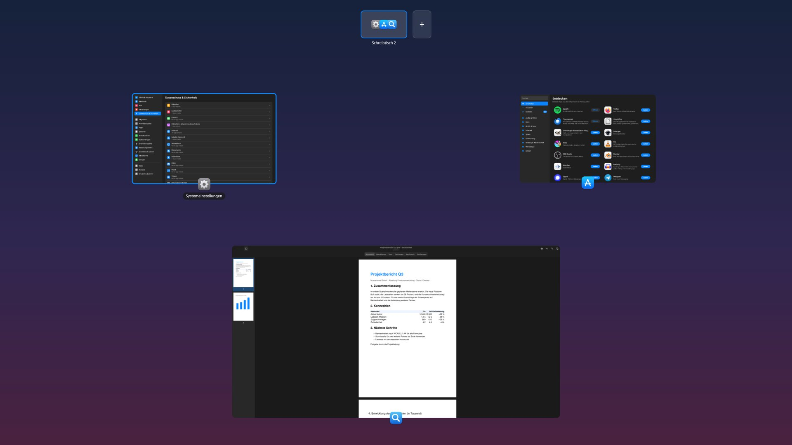
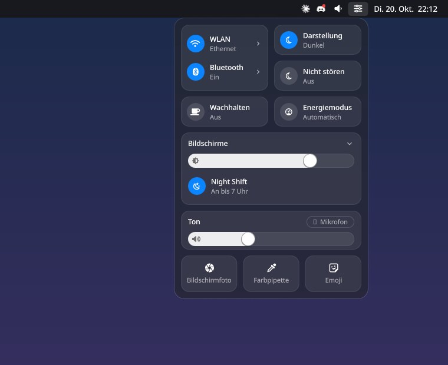
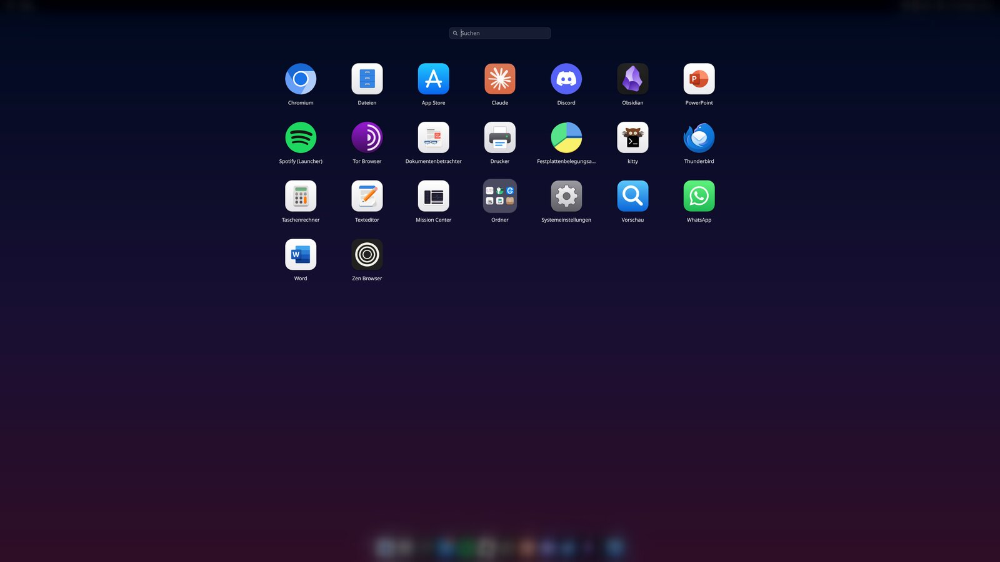
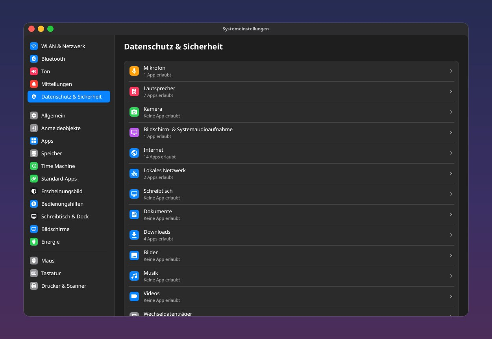
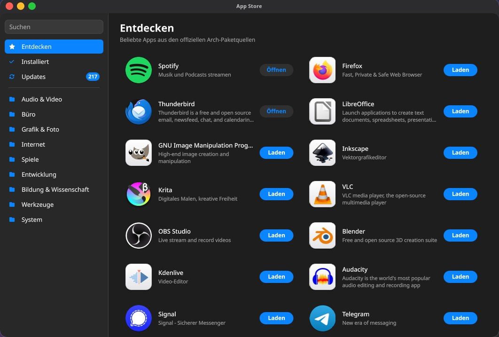
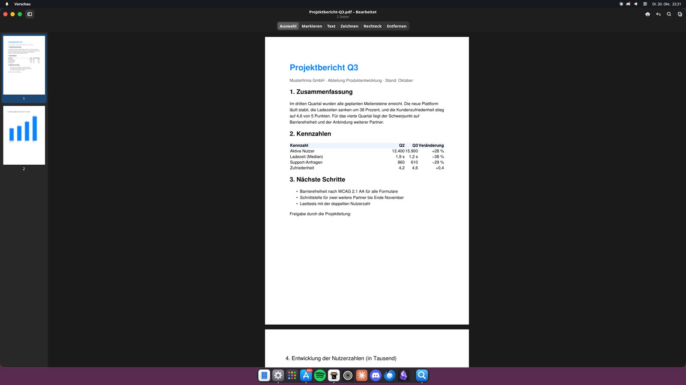

# riptide

**My own macOS-style desktop operating system, built on Arch Linux.**

## What is this?

riptide is a desktop operating system that I built on top of Arch Linux. It looks and works
a lot like macOS: it has a menu bar, a dock, Launchpad, Spotlight, Mission Control, a Control
Centre, System Settings and an App Store. All of this is my own code, running on the Hyprland
window manager.

It is more than a theme. riptide has its own background services, its own login, and every
app runs in a sandbox and has to ask before it can use the microphone, the camera, your
files or the network. I use it every day on my PC with two monitors. The user interface is
in German.

## Screenshots

| | |
|:---:|:---:|
|  |  |
| Control Centre | Launchpad |
|  |  |
| Privacy and Security settings | App Store |

Preview, my own PDF and image app

## What it can do

**Desktop**
- Menu bar and dock on every screen, with app menus, badges and drag and drop
- Launchpad with folders, and Spotlight (Super + Space) for apps, files, settings and quick math
- Mission Control with live window previews, several desktops and window snapping
- Notifications with a Notification Centre, Do Not Disturb and reply buttons
- Control Centre for Wi-Fi, Bluetooth, sound, Night Shift and the brightness of external monitors

**Apps**
- System Settings with 19 pages. Every change works right away, without a restart
- App Store for the official Arch repositories, including updates
- Preview: view PDFs and images, highlight text, sign, fill in forms, move pages around
- Backups like Time Machine: hourly snapshots plus encrypted backups to an external disk

**System**
- Every app runs in its own sandbox with permissions you can change at any time
- The lock screen is also the login screen
- Warnings when the disk is almost full or a service fails, a message when an app crashes,
  and a daily error report
- A snapshot before every update and a script to roll the system back

## What I am most proud of

1. **Every app is sandboxed.** Apps run in a sandbox (bubblewrap) that only lets them see
   their own files. Microphone, camera, screen recording, folders, internet, local network,
   Bluetooth, USB devices and passwords are asked for the first time an app needs them, and
   you can take them back later. Every switch is really enforced by the system, not just
   shown in the settings.
2. **It works with normal Linux tools.** Each sandbox looks like a Flatpak app to the rest
   of the system, so the standard Linux permission tools (portals, PipeWire) also work for
   normal Arch packages.
3. **A safe login like on a Mac.** The PC starts straight into a locked session. Before the
   password is typed in, nothing else runs: no shortcuts, no dock, no apps, no USB drives.
   After the password, the desktop fades in and the apps from last time open again. There
   are always emergency ways in, so I can not lock myself out.
4. **One system instead of many plugins.** The interface talks to one background service,
   and only one small, checked helper can do things as root.
5. **My own window manager plugin** in C++ for title bars with traffic lights and Mac-like
   window behavior.

## How it works

| Part | What it does | Language |
|---|---|---|
| Shell | Everything you see: menu bar, dock, panels, System Settings, App Store | QML |
| riptide-session | Background service: sandboxes, permissions, updates, backups, warnings | Python |
| riptide-helper | The only way to root, for example to install apps or change the firewall | Bash |
| Hyprland config and plugin | Shortcuts, windows, desktops, title bars | Lua, C++ |

More details are in [docs/architecture.md](docs/architecture.md) and
[docs/security.md](docs/security.md).

## Numbers

- About 32,000 lines of code: QML 18,000, Python 7,500, Lua 2,800, C/C++ 1,700, Bash 1,500
- 200 commits in about four weeks

## What is not finished yet

- Secure Boot is prepared but not turned on yet
- Programs outside the sandbox can still record the screen without asking
- riptide is made for my own PC, so there is no installer for other computers

## How I built it

I built riptide together with Claude Code, an AI coding assistant. That is why the commits
list it as co-author. I decided what to build, set the rules (especially for security) and
tested everything on my own PC.

## License

MIT, see [LICENSE](LICENSE). The title bar code in `plugin/riptide-wm/titlebars/` is based
on hyprbars (BSD-3-Clause).

riptide is not connected to Apple. macOS, Spotlight, Launchpad, Mission Control, Time
Machine and App Store are trademarks of Apple.
