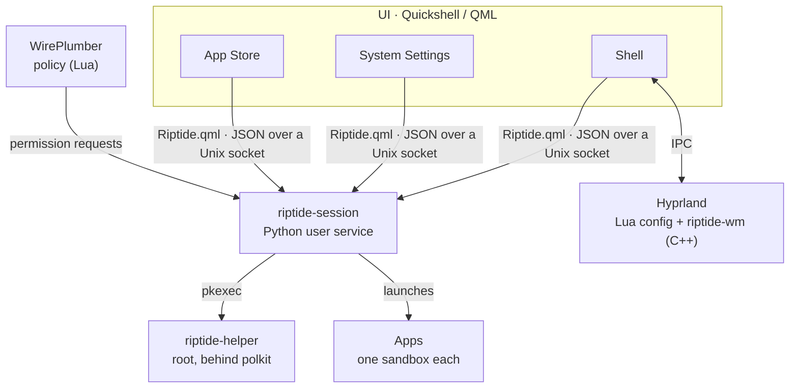

  

<h1 align="center">riptide</h1>

  <b>A macOS-style desktop operating system on Arch Linux – built as one coherent system, not a collection of plugins.</b>

  
  
  
  
  
  
  

riptide turns Arch Linux into a complete desktop with the logic of macOS (and Windows where
it does better): its own shell, System Settings, App Store, login, lock screen, notification
system, file preview, backups – and underneath an **app sandbox with per-app permissions**
for every program, a **single audited path to root** and a **hardened boot and login
chain**. Every setting applies live, without a rebuild or restart.

It is in daily use on a two-monitor desktop with NVIDIA graphics. The interface language is German;
code, comments and documentation are English.

> [!NOTE]
> This is a personal operating system built for one machine, published as a reference
> project. It is not a distribution and not meant to be installed as is (see
> [Running it](#running-it)).

---

## Contents

- [Screenshots](#screenshots)
- [What makes it special](#what-makes-it-special)
- [Features](#features)
- [Architecture](#architecture)
- [Security](#security)
- [Tech stack and numbers](#tech-stack-and-numbers)
- [Repository layout](#repository-layout)
- [Status and known limitations](#status-and-known-limitations)
- [Running it](#running-it)
- [How it was built](#how-it-was-built)
- [License](#license)

---

## Screenshots

| | |
|:---:|:---:|
|  |  |
| **Control Centre** – Wi-Fi, Bluetooth, focus, energy mode, hardware brightness of external monitors, Night Shift, sound, tools | **Launchpad** – all apps, folders, search, free arrangement |
|  |  |
| **Privacy & Security** – 19 permission kinds, each enforced by the system, every app listed per permission | **App Store** – official Arch repositories, updates, clean removal |

**Preview** – riptide's own PDF and image app: page thumbnails, reorder and rotate pages, highlight, text boxes, signatures, form filling, printing

The image at the top shows **Mission Control**: every window of the screen with a live preview and the desktops ("Spaces") above.

---

## What makes it special

- **Every app is sandboxed – with macOS-style permissions.** Apps from the Arch repositories
  run in a bubblewrap sandbox built per app: filtered D-Bus, a Wayland security context,
  its own systemd scope and only the devices and folders it may use. Microphone, camera,
  screen recording, folders, internet, local network, Bluetooth, USB devices, passwords and
  notifications are **asked on first use and revocable at any time**. Each switch is
  enforced by a real mechanism (PipeWire policy, nftables per cgroup, D-Bus filter, missing
  device nodes) – not just shown.
- **Flatpak's permission machinery without Flatpak.** Each sandbox carries a generated
  `/.flatpak-info`, so the standard XDG portals, PipeWire and the permission store recognise
  ordinary distribution packages exactly like Flatpak apps.
- **One system, three layers.** The UI (Quickshell/QML) talks to one session service
  (Python) through one socket; the session service reaches root only through one audited
  helper behind polkit. Knowledge about individual apps is data (`data/*.json`), not code.
- **A login like a Mac – without giving up safety.** The machine boots into a *locked*
  session: the lock screen is the login window, and after the password it fades straight
  into the desktop while the last session's apps reopen behind a progress bar. Before the
  password, no shortcut, menu bar, dock, login item or drive exists (fail-closed), and
  several emergency ways in always remain.
- **Own compositor plugin.** `riptide-wm` (C++) adds traffic-light title bars and macOS
  window behaviour to Hyprland, and emits events the shell builds on (tap ⌘ alone for
  Mission Control, reveal the menu bar and dock over full-screen apps).
- **Self-diagnosing.** Health checks (disk, SMART, btrfs errors, failed services), crash
  banners with "reopen", update and "restart required" detection, and a daily error report
  that collects seven log sources and filters known noise – each filter with its reason.
- **Honest security.** A switch appears only where the system enforces it; what is not
  enforced is labelled as such. The [security model](docs/security.md) names the open gaps
  as plainly as the defences.
- **Live everything.** Settings, theme, dark mode and accent colour apply instantly across
  the shell, GTK, Qt, the terminal, Thunderbird and the browser.

---

## Features

Shortcuts use Mac notation: ⌘ = Super (Windows key), ⌥ = Alt, ⌃ = Ctrl, ⇧ = Shift.

### Desktop

| | |
|---|---|
| **Menu bar** (every monitor) | System menu (About, Settings, Force Quit, Sleep, Restart, Shut Down, Lock, Log Out), app menu of the front app (new window, hide, show all windows, keep in dock, quit), clock, Control Centre, sound menu with per-app volume, tray icons in the system's style, eject menu for drives, privacy indicators |
| **Dock** (every monitor) | Pinned and running apps, drag to reorder / pin / unpin, bounce while starting, unread badges, update count on the App Store, right-click menu with app actions and "hide to menu bar" (app keeps running without a window); uniform icon shapes measured from each icon's pixels |
| **Launchpad** | Full-screen app grid over a blurred desktop, search (also inside folders), folders by drag and drop with automatic names, free arrangement, uninstall |
| **Spotlight** (⌘Space) | Apps, files (localsearch index), 27 System Settings pages, a calculator with its own safe parser (no `eval`; `2^10`, `√2`, `15% von 80`) and unit conversion (`5 km in m`, `100 °C in °F`) |
| **Mission Control** (⌃↑, hot corner, or tap ⌘) | All windows glide from their real positions into a grid with **live** previews; desktop strip on top; App Exposé (⌃↓) |
| **Spaces & full screen** | Desktops with ⌃←/→ and ⌃1–9; full screen like macOS: the window gets its own desktop and returns when it leaves; menu bar and dock slide in at the screen edge |
| **Window management** | Snapping to halves, quarters and full screen, ⌃⌥ arrows, minimize to dock, ⌘Tab app switcher and ⌥Tab window switcher, window positions remembered per monitor (by serial number, as connector names change) |
| **Title bars** | Traffic-light title bars from the riptide-wm plugin; apps that draw their own get none, choosable per app |
| **Hot corners** | Mission Control, app windows, desktop, Launchpad, Notification Centre, screens off, lock, sleep |

### Notifications

- Own notification server: banners with actions and **inline reply**, sender pictures
  (copied safely out of an app's sandbox), click runs the default action
- Notification Centre with stacks per app and a history of 50 across logins
- Per-app style: banner, alert (stays), Notification Centre only, off; the first
  notification of an app asks for permission
- **Do Not Disturb**: manual, on a schedule, automatically while sharing the screen or in
  full screen
- Sound per notification, switchable per app
- System banners: Bluetooth device connected (with battery), USB device recognised by kind,
  drive mounted, microphone muted, updates, health warnings, crashes ("„X“ quit
  unexpectedly" – reopen)

### Control Centre

- Wi-Fi with an unfolding network list and password dialog; Bluetooth with known devices,
  connect/disconnect and battery
- Light/dark, Do Not Disturb (shows why it is on), keep awake, energy mode
  (power-profiles-daemon)
- **Hardware brightness of external monitors over DDC/CI**, one slider each; Night Shift
- Volume, global microphone mute; tools: screenshot, colour picker, emoji picker; now playing
  (MPRIS)

### Login, lock and session

- **Lock screen = login window**, over the real wallpaper, fading into the desktop; a
  progress bar while login items and the last session's apps open (at most 15 s)
- Password field on a chosen main monitor; the other monitors show weather (Open-Meteo, only
  the place is sent), the month's calendar and what is playing
- Keyring unlocked with the login password; three wrong passwords → ten minutes' wait
- Log out / restart / shut down ask about unsaved work and list apps that do not quit;
  "reopen windows when logging back in"
- Locking by ⌘L, hot corner, idle timer or menu; emergency text login (⌃⌥F2), 40 s watchdog

### Own apps

| App | What it does |
|---|---|
| **System Settings** | 19 pages, live, deep-linkable (see below) |
| **App Store** | Browse, search and install from the official Arch repositories (AppStream catalogue), categories, app details with licence and source, progress rings, update all with live log, "restart required" banner; complete removal: the package, its orphaned dependencies and, if chosen, the app's data (to the trash) |
| **Preview** | One window with tabs for images, audio, video and **PDF**: thumbnails, reorder/rotate/delete/insert pages, search, text selection, highlight, text boxes, freehand drawing and **signatures**, **form filling**, password-protected PDFs, 30-step undo, printing |
| **Printers** | Print queue per printer: pause, resume, cancel, ink levels |
| **Time Machine** | Hourly btrfs snapshots of the home folder plus encrypted, deduplicated backups to an external disk (restic); schedule, retention, exclusions, "previous versions" browser; backup starts when the disk is plugged in |
| **Force Quit** (⌥⌘Esc) | Lists apps, marks unresponsive ones, ends every process of an app; own "app not responding" dialog |
| **About this computer**, **About "App"** | Hardware, drivers, system report; per app: version, source, size and **whether it runs sandboxed** |
| **Emoji & symbols** (⌃⌘Space), **clipboard history** (⌘V), **colour picker**, **screenshots** (⌘⇧3/4) | Small system tools in the same design |
| **Screen-share picker**, **admin password dialog**, **system questions** | Own dialogs for the portal, polkit and permission prompts; permission prompts cannot be confirmed by a script |

<b>System Settings – all 19 pages</b>

| Page | Contents |
|---|---|
| Wi-Fi & Network | Connections, networks with signal, connect/forget, **VPN** (WireGuard import) |
| Bluetooth | On/off, search, pair, connect, remove |
| Sound | Output and input device, levels, UI sounds, volume feedback |
| Notifications | Do Not Disturb (schedule, sharing, full screen), sound, style and sound per app |
| Privacy & Security | 19 permission kinds with a per-app list each; apps without sandbox listed honestly; status of disk encryption, Secure Boot, system files, firewall, last snapshot; firewall page with allowed services and remote login |
| General | Info (computer name, hardware, system report, "rebuild compositor plugin", error reports), date & time (NTP, time zone search), language & region with live preview |
| Login Items | Apps opened at login, background items with switches |
| Apps | Every installed app with source and size, complete removal |
| Storage | Usage by category, empty trash, auto-empty after 30 days, clean package cache |
| Time Machine | Backup disk, schedule, retention, exclusions, previous versions |
| Default Apps | Browser, mail, files, PDF, pictures, music, video, text, archives |
| Appearance | Light / dark / automatic (by time), 8 accent colours, menu bar transparency, frosted blur, wallpaper, title bar per app |
| Accessibility | Reduce motion, increase contrast, text size, screen zoom (⌥⌘8, ⌥⌘+/−) |
| Desktop & Dock | Dock size, snapping, gaps, corner radius, hot corners |
| Displays | Resolution, refresh rate, scaling, main monitor for login, lock screen widgets, Night Shift schedule and temperature |
| Energy | Lock / screens off / sleep after …, energy mode, reopen windows at login |
| Mouse | Natural scrolling, speeds, pointer style and size |
| Keyboard | Layout, **Mac shortcuts with ⌘** (⌘C/⌘V/⌘Z in every app), key repeat, searchable list of ~60 shortcuts |
| Printers & Scanners | Driverless IPP printers (also by IP address), default printer, ink levels, test page, scanners |

### System services

| | |
|---|---|
| **App sandbox** | bubblewrap per app, xdg-dbus-proxy, Wayland security context, systemd scope per app, nested sandbox for helper processes, links and files handed over through the portal to the default app's own sandbox |
| **Permissions** | 19 kinds in the XDG permission store; prompts on first use; revoking cuts running audio/video streams at once |
| **Local network per app** | nftables rules matched on the app's cgroup v2 scope; the first blocked attempt asks |
| **Updates** | Background check every 6 h (pacman, release-archive apps), App Store badge, "restart required" after kernel/NVIDIA updates, "log in again" after Hyprland updates, plugin rebuilt automatically |
| **Release-archive apps** | Apps outside the repositories (the Zen browser) installed from the maker's GitHub release: SHA-256 checked, atomic swap, own updater disabled, program folder read-only in the sandbox |
| **Health** | Disk almost full, SMART warnings, btrfs error counters, failed services – once a day, with a button that helps |
| **Crashes** | systemd-coredump mapped to the app's scope; banner with "reopen" |
| **Drives** | Auto-mount (never while locked), eject with power-off, names the programs blocking an eject; Android (MTP) and iPhone (AFC) in the file manager |
| **Error report** | `riptide-report`: one daily Markdown report from failed units, core dumps, compositor errors, shell log, service and app output; messages normalised and counted |
| **Theming** | One design-token file (`data/theme.json`) drives the shell, GTK 3/4, Qt, kitty, Thunderbird (Outlook-like layout) and the browser |
| **Web apps** | WhatsApp, Word and PowerPoint as sandboxed Chromium app windows with their own dock icons; every other link goes to the default browser |

### Boot and recovery

- Limine boot menu (3 s, editor off) with **unified kernel images**; LUKS2 unlocked by TPM2
- Secure Boot in four staged scripts (own keys + Microsoft's, sealed Limine config, TPM
  re-bound to PCR 7, cleanup)
- Rescue mode (LTS kernel to a text login) in Limine and in the firmware boot menu
- Snapshot before every pacman transaction (snap-pac) and a [rollback script](docs/rollback.md)
  that swaps the root subvolume and rebuilds the boot images – also from the Arch ISO

---

## Architecture

| Layer | Owner |
|---|---|
| UI | Quickshell: shell, System Settings and App Store as separate instances with one design system; talks to the layer below only through `Riptide.qml` |
| Session services | `riptide-session`: permissions and prompts, every app's sandbox, portal backend, updates, health, crashes, drives, backups |
| Root | `riptide-helper`: one polkit action per area (packages, firewall, local network, remote login), every argument checked |
| Integration points | Hyprland Lua config, **one** compositor plugin, **one** WirePlumber policy script, **one** portal backend |

More: [docs/architecture.md](docs/architecture.md) – protocol, sandbox launch sequence,
how each permission is enforced, login and boot chain, packaging.

---

## Security

| Attacker | Protection |
|---|---|
| At the machine, locked | One door: the password. Before it, no shortcuts, no shell UI, no login items, no mounted drives; every crash path stays locked |
| A sandboxed app | Own data only; no compositor/shell/session sockets; no screen capture, input injection, background clipboard or overlays; everything else asked and revocable |
| Root | One helper, whitelisted actions, checked arguments, packages only from official repositories, protected system packages |
| Network | Firewall on, SSH off, local network per app |
| Machine off | LUKS2 + TPM2; Secure Boot staged (open – see below) |

The full threat model, including what is **not** protected yet, is in
[docs/security.md](docs/security.md).

---

## Tech stack and numbers

| | |
|---|---|
| Base | Arch Linux (official repositories only), Hyprland 0.56 with Lua config, Quickshell 0.3, uwsm, greetd, PipeWire/WirePlumber, NetworkManager, BlueZ, UDisks2, CUPS, firewalld, snapper, restic, Limine, systemd |
| Languages | QML/JavaScript (UI), Python (services, Preview), Lua (compositor and audio policy), C++ (compositor plugin), C (Wayland security-context helper), Bash (system setup, root helper) |
| Size | ~32,000 lines of code: QML/JS 18,000 · Python 7,500 · Lua 2,800 · C/C++ 1,700 · Shell 1,500 |
| History | ~200 commits, September–October 2026 |

---

## Repository layout

The repository is laid out like the installed system (`/usr/lib/riptide`).

| Path | Content |
|---|---|
| `shell/` | Quickshell UI: shell, System Settings (`settings/`), App Store (`appstore/`), printer app, helper scripts |
| `session/desktop_shell/` | `riptide-session`: sandbox, permissions, portal backend, updates, health, drives, Time Machine, Preview … |
| `hypr/` | Hyprland Lua config and modules |
| `plugin/riptide-wm/` | Hyprland plugin (C++) |
| `sandbox/` | `wl-security-context` (C) – Wayland security context per app |
| `wireplumber/` | Per-app microphone/speaker/camera policy |
| `bin/` | Commands: `app-sandbox`, `app-permissions`, `riptide-report`, `desktop-theme`, `preview` … |
| `data/` | App knowledge and design tokens: `sandbox.json`, `archive-apps.json`, `titlebars.json`, `theme.json`, icons |
| `systemd/` | User units: shell, session, backup, report |
| `system/` | Root-owned files (greetd, greeter, root helper, polkit, Limine, UKI presets), `setup-os.sh`, Secure Boot stages, rollback |
| `packaging/` | pacman package `riptide` and developer mode |
| `docs/` | [Architecture](docs/architecture.md), [security model](docs/security.md), [rollback](docs/rollback.md), [Secure Boot](docs/secure-boot.md) |

---

## Status and known limitations

riptide is in daily use. Open, and stated as such in the system itself:

- **Secure Boot** stages 2–4 are written but not run yet; until then the TPM unlock is the
  weak spot against an attacker with the machine powered off.
- **System files owned by root:** the package exists and is installed; developer mode is on
  while development continues, and the home folder still links into the system tree.
- **Screen capture by unsandboxed programs** is not asked yet (Hyprland
  `enforce_permissions` is written but off).
- Notifications are attributed by the app's own claim (desktop-entry hint), not by its D-Bus
  connection.
- Hardware-specific values (monitor names, the LUKS device, NVIDIA environment, keyboard
  layout) are set for the machine it runs on.

---

## Running it

riptide is built for one machine and not packaged for others. To study or reuse parts:

1. Arch Linux with Hyprland 0.56 and Quickshell 0.3.
2. `sudo ./install.sh packages` – the packages in `packages.txt` (official repositories only).
3. `./install.sh link` and `./install.sh services` – link the software into the home folder
   and enable the user services.
4. `sudo system/setup-os.sh` – the root-owned parts (root helper, polkit, portal backend,
   greetd login, firewall, snapshots, boot entries). Read it first: it changes the boot
   configuration.
5. `plugin/build.sh` – build the compositor plugin against the installed Hyprland.

---

## How it was built

riptide was developed in pair-programming sessions with
[Claude Code](https://claude.com/claude-code) (Anthropic) as the AI pair programmer – the
commits say so in their `Co-Authored-By` lines. Requirements, design decisions, the security
rules and all testing on real hardware come from the author.

---

## License

[MIT](LICENSE). `plugin/riptide-wm/titlebars/` is derived from
[hyprbars](https://github.com/hyprwm/hyprland-plugins) (BSD-3-Clause, licence kept in that
folder).

riptide is an independent project, not affiliated with Apple. macOS, Mac, Spotlight,
Launchpad, Mission Control, Time Machine and App Store are trademarks of Apple Inc. and are
used only to describe the behaviour riptide imitates. Other names belong to their owners.
