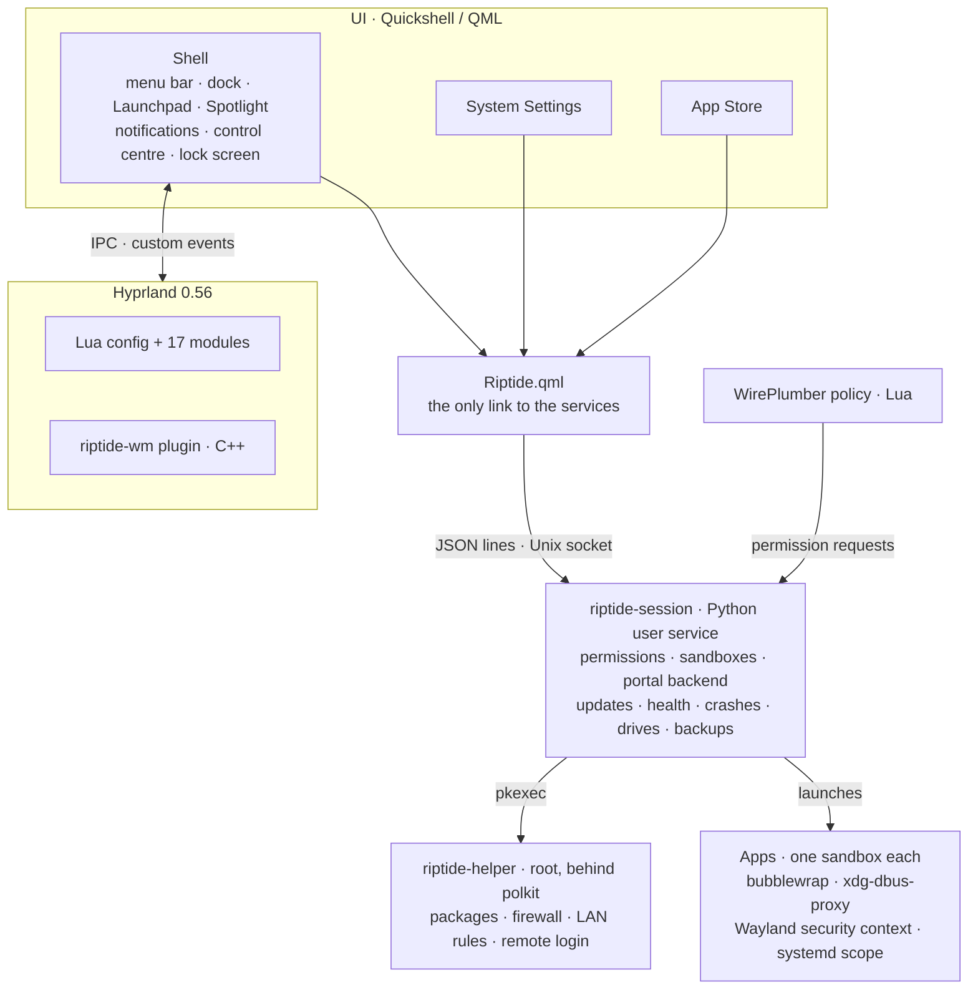
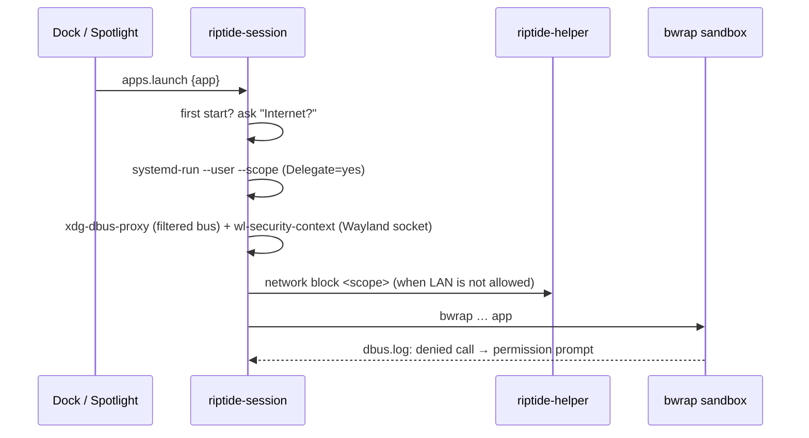
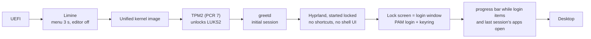

# Architecture

riptide is built as **one system with few owners**, not as a collection of plugins and
scripts. Every concern has exactly one place in the code; everything app-specific is data.

## Principles

1. **One building block per job.** Features are assembled from existing components
   (`Glass`, `Banner`, `AppIcon`, `Confirm`, `Page`, `Group`, `SettingRow`, `Toggle`,
   `Choice` …), never copied.
2. **One service per system area.** A singleton owns the logic (`NotificationStore`,
   `Wifi`, `BtDevices`, `Updates`, `Drives` …); pages and panels only display it.
3. **Settings apply live.** One `settings.json`, watched by the shell, the compositor
   config and the services. No rebuild, no restart.
4. **Root only through one audited helper** behind polkit, one action per area, every
   argument checked. Never a general "run as root".
5. **Honest security.** A switch exists only where the system really enforces it.
   What is not enforced is shown as such.

## Layers

| Layer | Owner | Talks to others through |
|---|---|---|
| UI | Quickshell: the shell, System Settings and the App Store are separate instances sharing one design system | `Riptide.qml` → session socket; Hyprland IPC; Quickshell IPC (`qs ipc`) |
| Session services | `riptide-session` (`session/desktop_shell/`), one GLib main loop | Unix socket `$XDG_RUNTIME_DIR/riptide/session.sock` (0600 in a 0700 dir), D-Bus, portal backend |
| Root | `riptide-helper` (`system/files/usr/local/sbin/riptide-helper`) | pkexec with one polkit action per area |
| Compositor | Hyprland Lua config (`hypr/`) + the `riptide-wm` plugin (`plugin/`) | `hyprctl dispatch 'macos.…'`, custom IPC events |
| Audio/video policy | one WirePlumber script (`wireplumber/scripts/macos/app-permissions.lua`) | PipeWire metadata `macos-permissions` |

Why this shape: fewer processes (no launcher per app, no watcher scripts in the shell),
one place per concern, one API the UI talks to, and an upstream update breaks one known
place instead of many. Restarting the session service leaves running apps alone.

## The shell (Quickshell)

- `shell/shell.qml` is the desktop: one menu bar and dock per screen, plus panels,
  banners, dialogs and the lock screen. `settings.qml`, `appstore.qml` and
  `printers.qml` are separate Quickshell instances with their own window and dock icon.
- ~30 singletons own the system areas (`Config`, `Apps`, `Privacy`, `NotificationStore`,
  `Banners`, `Session`, `Lock`, `Wifi`, `BtDevices`, `Brightness`, `NightShift`, `Drives`,
  `Updates`, `Weather`, `MainScreen` …). System Settings gets its own copy of a singleton;
  both read the same system service (NetworkManager, BlueZ, PipeWire).
- The design tokens live in `data/theme.json` (fonts, radii, accent, traffic-light colours,
  25 tokens per light/dark mode). The same file drives GTK, Qt, kitty, Thunderbird and
  the browser through `bin/desktop-theme`.
- The shell is its own notification server, polkit agent, StatusNotifier host, MPRIS
  client, screen-share picker and Hyprland dialog provider.

## riptide-session

One Python process (PyGObject/Gio) started as a systemd user service.

**Protocol.** One JSON object per line. A client says `hello` with a role (`shell`,
`settings`, `tool`). Calls: `permissions.set/request`, `apps.launch`, `apps.sync`,
`screen.pick`, `access.answered`, `updates.check`, `drives.mount/eject`, `status`.
Events: `permissions`, `request`, `streams`, `share`, `access`, `updates`, `drives`,
`session-ask`. When the shell reconnects, everything pending is replayed; an unanswered
permission prompt counts as "no" after 300 s; no single call can crash the service.

**Portal backend** (`org.freedesktop.impl.portal.desktop.riptide`): `Access` (portal
questions in the system's own dialog), `Background` (autostart entries that start the app
in its sandbox) and `AppChooser` (answers "which app opens this?" with the default app,
like macOS).

| Module | Job |
|---|---|
| `sandbox.py` | builds and starts each app's sandbox (below); keeps a sandboxed override for every installed desktop entry in sync |
| `permissions.py` | 19 permission kinds, stored in the portal PermissionStore (the one Flatpak uses): yes / no / ask |
| `lan.py` | "local network" per app: nftables rules on the app's cgroup; the first blocked attempt asks |
| `archive_apps.py` | apps from a maker's release archive (Zen browser): SHA-256 from GitHub required, atomic swap with `renameat2(RENAME_EXCHANGE)`, own updater off, program folder read-only in the sandbox |
| `updates.py` | background check (pacman via `checkupdates`, archive apps); detects "restart needed" (kernel/NVIDIA) and "log in again" (Hyprland) |
| `health.py` | disk almost full, SMART warnings, btrfs error counters, failed units – each at most once a day |
| `crashes.py` | follows systemd-coredump, maps the crash to the app's scope, offers "reopen" |
| `drives.py` | UDisks2: mounts external drives – never while locked –, ejects and powers off, names the programs that block an eject |
| `timemachine.py` | hourly btrfs snapshots of the home folder (snapper) + encrypted, deduplicated backups to an external disk (restic, password in the keyring) |
| `trash.py`, `login_items.py` | trash older than 30 days; login items that follow their app's start entry |
| `report.py` | `riptide-report`: one Markdown report from seven log sources, messages normalised and counted, known noise filtered with a reason per rule |
| `preview.py`, `pdf_document.py` | the Preview app (GTK4/libadwaita, tabs) and its UI-free PDF model (PyMuPDF) |

## App sandbox

Every app that is not a system app is started by `app-sandbox <desktop-id>` – from the
dock, Spotlight, Launchpad, a link or a file opened by another app (overrides of the desktop
entries and D-Bus services make sure nothing starts around it).

What the app sees:

- `/usr` and `/etc` read-only, a private `/tmp`, a per-app home folder with only its own
  data folders, the look (themes, fonts) read-only, and the user folders it was allowed.
- A fresh runtime directory with only its Wayland socket, its D-Bus proxy, PipeWire (unless
  both microphone and speakers are denied) and its document-portal folder. Hyprland's
  socket, the shell's IPC and the session socket are not there.
- Devices: the GPU; HID/USB and cameras only when allowed; never `/dev/snd`.
- `--cap-drop ALL`, new PID/IPC/cgroup namespaces, a cleared environment with an allowlist.
- A generated `/.flatpak-info`: the portals, PipeWire and the shell recognise the app
  exactly as they would a Flatpak, so the standard permission machinery works for apps
  from the Arch repositories.

| Permission | Enforced by |
|---|---|
| Microphone, speakers | no `/dev/snd`; the WirePlumber policy hides devices and holds undecided streams |
| Camera | no `/dev/video*`; only through the camera portal |
| Screen & system audio | Wayland security context (no direct capture); only through the portal and riptide's picker |
| Files and folders | folders exist in the sandbox only when allowed; single files through the portal dialog |
| Internet | denied: `--unshare-net` (no network at all); asked before the first start |
| Local network | nftables rules matched on the app's cgroup v2 scope |
| Bluetooth, passwords | D-Bus filter (BlueZ, Secret Service) |
| USB & input devices | `/dev/hidraw*` only when allowed |
| Notifications, background | D-Bus filter + riptide's notification server; Background portal |
| Location, input injection, other windows | not available in the sandbox |

Links and files an app opens leave the sandbox through the portal and open in the default
app – in that app's own sandbox. Helpers that libraries try to start through
`flatpak-spawn` run in a nested sandbox; `--host` is refused.

## Compositor

`hypr/hyprland.lua` loads 17 modules: keys, window rules, snapping, the ⌘Tab/⌥Tab switcher
logic, window memory (frames keyed by the monitor's serial, because connector names
change), Mac-style full screen on its own desktop, title-bar rules, accessibility,
notifications for config errors (never Hyprland's red error bar) and the bridge the shell
calls (`macos.activate_app`, `macos.quit_app`, `macos.hide_app` …).

The **riptide-wm** plugin (C++, built against the installed Hyprland, refused on an API
mismatch, rebuilt automatically after a Hyprland update):

- title bars with traffic lights (derived from hyprbars, BSD-3), with fixes for drags that
  lost their release and a stencil state that hid the bars on NVIDIA
- answers `xdg_toplevel.move` from apps that draw their own title bar, minimize to a hidden
  desktop, zoom, full-screen requests routed to the Lua logic
- the top edge moves instead of resizing; the menu bar acts as a border
- events for the shell: `super-tap` (⌘ tapped alone → Mission Control) and
  `fullscreen-edge` (pointer at the edge of a full-screen app → menu bar or dock slide in)

## Login and boot

- **One passage, like on a Mac.** greetd logs in at boot, but the session starts *locked*:
  until the password, only Hyprland and the lock screen run. No shortcut is bound, the menu
  bar and dock exist only under a confirmed session lock (fail-closed), login items wait
  behind an `ExecCondition`, the keyring stays closed, no drive is mounted.
- After a logout, a greeter running as an unprivileged user restarts greetd so the next
  session starts locked again (`relock`, which accepts only matching, fresh timestamps).
- **Emergency ways in**, all with a password: a text login if the login window does not
  come up, ⌃⌥F2, a 40 s watchdog, a rescue boot entry (LTS kernel, text login) in Limine and
  in the firmware's boot menu.
- Secure Boot: staged scripts (`system/secure-boot/`): UKIs (done), own keys + Microsoft's
  and a sealed Limine config, TPM re-bound to PCR 7, removal of unsigned entries.
- Rollback: snap-pac snapshots every pacman transaction; `system/snapshot-rollback` swaps
  `@` for a snapshot and rebuilds the boot images (`docs/rollback.md`).

## System files owned by root

The software is packaged as the pacman package `riptide` (`packaging/`) and installed to
`/usr/lib/riptide`, root-owned and verifiable with `pacman -Qkk riptide`. **Developer
mode** – like turning off SIP on a Mac – is a root-owned switch that binds the repository
read-only over `/usr/lib/riptide` at boot, so edits are live while developing. System
Settings shows plainly which mode is active. The root helper is installed outside that tree
so developer mode can never replace it.

## Data instead of code

What the system knows about single apps is data in `data/`:

- `sandbox.json` – per-app sandbox profiles (extra data folders, devices, arguments,
  environment) and the system apps that run unsandboxed; every other app gets the defaults
- `archive-apps.json` – apps installed from release archives
- `titlebars.json` – apps that draw their own title bar
- `theme.json` – the design tokens
